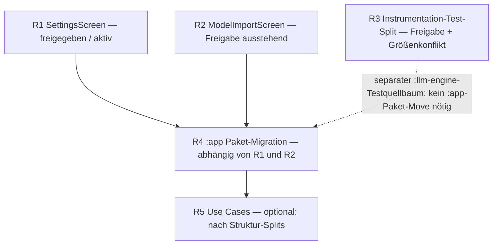

# Refactoring Roadmap — Live Statusregister für Agents

**Zweck:** einziger aktueller Register für offene, freigegebene und blockierte Refactoring-Aufgaben in `MrLongNight/Local_LLM_Engine`. Nach jedem Code-Commit, CI-Ergebnis, Fehler und Freigabeschritt aktualisieren.

**Snapshot:** 14.11.2026  
**Settings-Code-HEAD:** `4492dc3ec7a281cd64640f0186482f98fc07fca8`  
**Branch-Regel:** nur `main`; keine Feature-Branches.

**Gespeicherte Mermaid-Übersicht:** [Refactoring-Roadmap und Abhängigkeiten öffnen](https://mermaid.ai/app/projects/d7b9e612-2e4e-4eba-ac5b-098c4d58b067/diagrams/50efdfab-718e-4578-8580-01c437062111/version/v0.1/edit?utm_source=mermaid_app_widget&utm_medium=mermaid-chatgpt-app)  
**Mermaid documentID:** `50efdfab-718e-4578-8580-01c437062111`

## Statuslegende

- **IN PROGRESS / APPROVED** — Umsetzung im genehmigten Scope erlaubt.
- **ANALYSE FERTIG / FREIGABE AUSSTEHEND** — Plan dokumentiert; keine Codeänderung.
- **BLOCKED** — Zielkonflikt oder fehlende Voraussetzung; Umsetzung gestoppt.
- **DEPENDENCY** — muss auf vorgelagerte Tasks warten.
- **DONE** — nur nach Diff-, CI- und Akzeptanzprüfung.

## Task-Register

| ID | Task | Status | Freigabe | Nächstes Gate |
|---|---|---|---|---|
| R1 | `SettingsScreen.kt` Sektionsextraktion | **IN PROGRESS**; `SystemPromptSection` extrahiert | **Nutzer hat freigegeben** | Unit Tests grün; APK-Build/Artifacts erfolgreich; Emulator-Recovery-Test fehlgeschlagen, Retry Attempt 2 läuft |
| R2 | `ModelImportScreen.kt` Sektionsextraktion | **ANALYSE FERTIG** | **Freigabe ausstehend** | Nutzerfreigabe; keine Codeänderung |
| R3 | `InferenceServiceProcessTest.kt` Testklassen-Split | **ANALYSE FERTIG + DATEIGRÖSSENKONFLIKT** | **Freigabe ausstehend** | Entscheidung zu >10-KB-Testdatei und Class-Qualified Reporting |
| R4 | `:app` Paket-/Layer-Reorganisation | **INVENTAR FERTIG** | **Freigabe ausstehend** | MainActivity/Manifest-Policy und Package-Deklarations-Scope freigeben |
| R5 | ViewModel-Pure-Logic in Use Cases / Repositories | **KANDIDATEN ANALYSIERT; BLOCKED** | **Freigabe ausstehend** | Nur `configurationTestSafetyBlock()` ist substanzieller Kandidat; klären, ob Wiederverwendungsbedarf besteht |

## Abhängigkeiten / vorgeschlagene Reihenfolge

R1 bleibt aktiv und wartet nicht auf Freigaben für R2–R5. R2 und R3 können unabhängig geplant werden, benötigen aber vor Codeänderung jeweils eine eigene Freigabe. R4 aktualisiert sein Inventar nach R1/R2; R3 betrifft `:llm-engine` und ist kein zwingender Input für das `:app`-Paketinventar. R5 ist optionale Architekturarbeit und darf nicht mit reinen Moves vermischt werden.

## Detaildokumente

- [R1 — SettingsScreen](REFACTORING_SETTINGS.md)
- [R2 — ModelImportScreen](REFACTORING_MODEL_IMPORT.md)
- [R3 — InferenceServiceProcessTest](REFACTORING_TESTS.md)
- [R4 — :app Paket-Inventar](REFACTORING_PACKAGES.md)
- [R5 — Use-Case-Kandidaten](REFACTORING_USE_CASES.md)
- [Frühere EngineViewModel-Splits](REFACTORING_ENGINE_VM.md)

## CI- und Ergebnisregeln

1. Tasks mit Freigabe ausstehend oder BLOCKED niemals implementieren.
2. Pro verschobener Sektion/Klasse Baseline, Zielpfad, 1:1-Body-Vergleich, Datei-Bytezahl und Commit-Hash festhalten.
3. GitHub-Only Workflow: ein Code-Commit pro freigegebener Sektion, danach exakte SHA-CI abwarten. Kein weiteres Code-Commit, solange Build/Test-Gate läuft oder fehlschlägt.
4. Unit-Test-Erfolg belegt keinen Native APK Build. APK-Erfolg belegt keine Emulator-Instrumentation. Emulator-Erfolg belegt keine Zieltelefon-Abnahme.
5. Bei APK-Workflow APK-Build-Schritte, Artifact Upload und nachgelagerte Emulator-Teststufe separat ausweisen.
6. Exakte Actions-Run-ID, Attempt, Code-SHA, Conclusion, failing Step und Artifact-Namen/-IDs dokumentieren.
7. Roadmap und Task-Detaildatei gemeinsam aktualisieren; Mermaid-Übersichten nach Struktur-/Pfad-/Statusänderungen aktualisieren.
8. Zielkonflikte belegen und Entscheidung einholen, statt Test-/Code-Inhalt umzuschreiben, um Akzeptanz künstlich zu erfüllen.

## Aktueller CI-Snapshot — Settings

- Code-HEAD `4492dc3ec7a281cd64640f0186482f98fc07fca8`.
- Unit Tests Run [43557763450](https://github.com/MrLongNight/Local_LLM_Engine/actions/runs/43557763450): **completed / success**.
- APK Workflow Run [43557763490](https://github.com/MrLongNight/Local_LLM_Engine/actions/runs/43557763490), Attempt 1: Gradle APK-/Instrumentation-APK-Build, Manifest-Checks und beide Artifact Uploads erfolgreich. Emulator-Test `realGgufIsReloadedAndFollowupInferenceSucceedsAfterTimeoutKill` fehlgeschlagen: Zeile 393 erwartete `DEBUG_NATIVE_INFERENCE_BLOCKED`, erhalten wurde `MODEL_LOADED`.
- Artifact IDs des fehlgeschlagenen Gesamtworkflows: Debug APK `14099167164`; Instrumentation Test APK `14100095064`.
- **Retry Attempt 2** wurde gestartet. Letzter Check: Workflow `in_progress`, aktiver Schritt `Run process-isolation instrumentation tests on Android emulator`. Für Attempt 2 liegen neue APK-Artefakte vor: Debug APK `14099708612`, Instrumentation APK `14099983067`. Retry-Resultat noch offen.
- Derselbe Test und alle für den Fehler relevanten Engine-/JNI-/CMake-/Workflow-Dateien haben identische Blob-SHAs zum vorherigen grünen APK-Run `43556762673` / Code-HEAD `a6bcd532be45bc7d08381ed802c388dd6219cf4e`. Das ist ein bisher nicht deterministisch reproduzierter Emulator-Testfehler; nicht als Settings-Code-Regression ausgeben.
- Vorheriger ViewModel-Code-HEAD `a6bcd532be45bc7d08381ed802c388dd6219cf4e`: Unit Run `43556762677` success; APK Run `43556762673` success; beide Artefakte hochgeladen.
