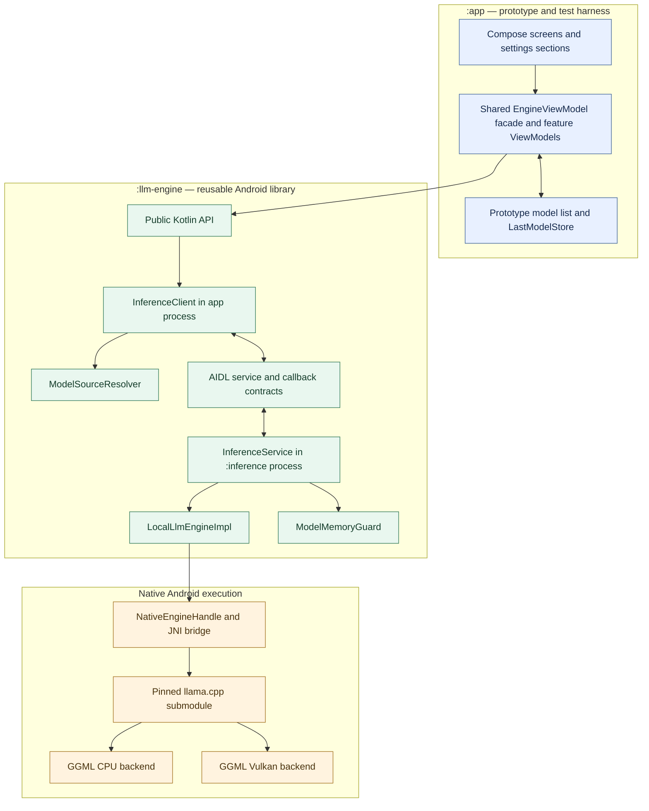
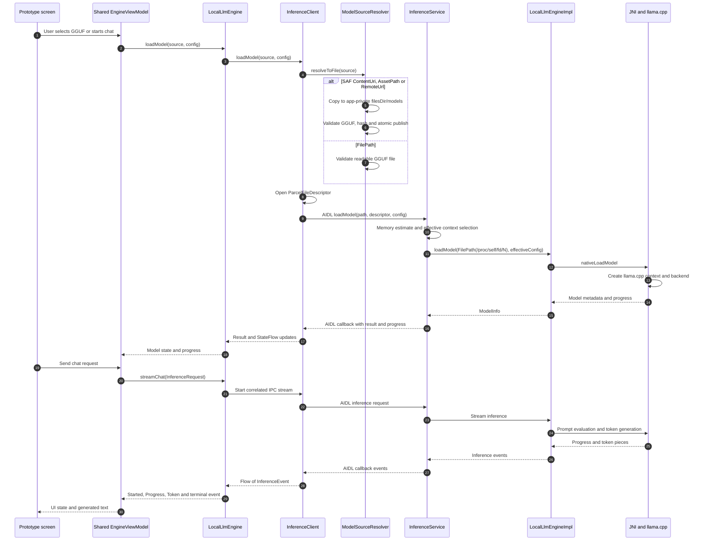

# Architecture — Local LLM Engine

**Scope:** Current prototype application and reusable `:llm-engine` library. This repository is not the myDocAnizer-Mobile application; the planned downstream integration is documented separately in [`../planning/INTEGRATION_MYDOCANIZER.md`](../planning/INTEGRATION_MYDOCANIZER.md).

**Source review baseline:** code commit `3426533a8d7e6c4be99e898d75ad70586446eb53` (2026-11-14). Current follow-up measures are maintained only in [`../active-todos/MASTER_TODO.md`](../active-todos/MASTER_TODO.md).

This is the canonical architecture document for the repository. Update it in the same commit whenever module boundaries, package ownership, process boundaries, public API, model flow, IPC or native backend flow changes. Do not maintain competing copies of these diagrams elsewhere.

## 1. Module and runtime boundaries

### Ownership and dependency rules

- `:app` is the prototype/test harness. Screens, prototype settings, model-list UI and app-specific last-model persistence belong here. Screens share the same `EngineViewModel` facade.
- `:llm-engine` owns reusable engine behavior. It must not depend on `:app`, Compose UI, Room or DMS-specific entities.
- Public consumer-facing contracts live in `com.mydocanizer.llm.engine`. Implementation details belong in `internal` and `ipc` packages.
- AIDL contracts live under `llm-engine/src/main/aidl/`. The library manifest owns the private `InferenceService` declaration.
- JNI, CMake, checked Android overlays and the pinned llama.cpp submodule live under `llm-engine/src/main/cpp/`. The upstream submodule itself stays unmodified.
- `InferenceService` runs in a separate `:inference` process under the same app UID (`isolatedProcess=false`); it is not an Android isolated-UID service.

## 2. Model load and inference sequence

## 3. Source layout and placement

| Area | Responsibility |
|---|---|
| `app/src/main/java/com/example/ui/` | Prototype screens, shared `EngineViewModel` facade and feature ViewModels. |
| `app/src/main/java/com/example/ui/settings/sections/` | Focused composable sections used by `SettingsScreen`. |
| App-side model helpers/ViewModels | Prototype-only model selection, app persistence and import orchestration. |
| `llm-engine/src/main/java/com/mydocanizer/llm/engine/` | Public API, request/config/state/result/model types and diagnostics facade. |
| `llm-engine/src/main/java/com/mydocanizer/llm/engine/internal/` | Engine implementation, source resolver, native handle, memory guard and internal helpers. |
| `llm-engine/src/main/java/com/mydocanizer/llm/engine/ipc/` | Inference client/service, Binder lifecycle and IPC coordination. |
| `llm-engine/src/main/aidl/` | AIDL interfaces and parcelable declarations crossing the process boundary. |
| `llm-engine/src/main/cpp/` | CMake, JNI bridge, checked Android overlays and pinned llama.cpp submodule. |
| `app/src/test/`, `llm-engine/src/test/`, `llm-engine/src/androidTest/` | JVM/host tests and Android instrumentation for the corresponding production responsibility. |

## 4. Architecture documentation gate

Before a code change:

1. Inspect the existing module/package tree and the nearest implementation before creating or moving files.
2. Choose the final responsibility-aligned file, package and module before writing the implementation. Do not place code temporarily in a convenient but incorrect location.
3. Reuse existing contracts and helpers; check whether equivalent functionality already exists before introducing a new class or abstraction.
4. Review the Mermaid diagrams and source-layout table against the proposed change.

After a structural code change, update the affected Mermaid diagram(s) and source-layout table in the same commit. For a change that does not alter architecture or control flow, leave the diagrams unchanged rather than editing them decoratively.

The diagrams describe ownership and control flow. They do not prove backend availability, GPU layer offload, model compatibility or performance; those require runtime diagnostics and device acceptance.
